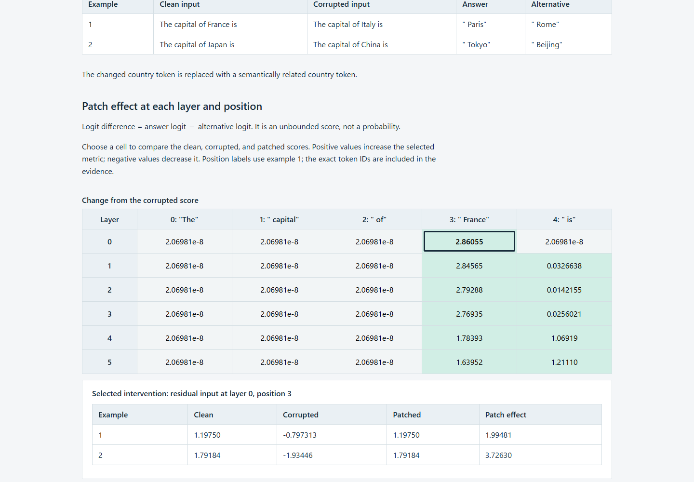

# Activation Intervention Lab

Inspect how replacing one residual-stream activation changes a trained language model's next-token scores. Run controlled inputs locally and explore layer/position effects in an interactive, offline HTML report.



Select the corruption, metric and example, then choose a cell to compare clean, corrupted and patched scores. The report keeps answer probability separate from answer-logit difference.

## Try it

The recorded environment uses Python 3.12. Keep the Windows environment path short. Git is required to install the pinned library. From the repository root, in PowerShell:

```powershell
$activationEnv = Join-Path $env:TEMP "activation-lab-venv"
python -m venv $activationEnv
& "$activationEnv/Scripts/python.exe" -m pip install torch==2.14.1 --index-url https://download.pytorch.org/whl/cpu
& "$activationEnv/Scripts/python.exe" -m pip install ".[test]" -c constraints-verified.txt
& "$activationEnv/Scripts/activation-lab.exe" --output activation-report
```

Linux/macOS: create and activate `.venv`, use the same pip commands, then run `activation-lab --output activation-report`. The first run downloads the open Pythia-14m checkpoint. No API keys or paid service are used. Later runs can use `activation-lab --offline --output activation-report-offline`.

Open `activation-report/report.html`. `report.json` contains exact inputs/token IDs, model revision and hashes, raw metrics, controls, all timing repetitions and resource measurements. Use a fresh output directory; earlier successful and failed runs are preserved.

## What changed

The copied patching core has an opt-in path that groups independent residual patches into bounded batches. It preserves patch indices, example/metric axes, reductions and the upstream result format. API batch size one keeps the copied serial path. CLI admission also precedes its repeated-input numerical control.

In the recorded FP64 CPU experiment, 30 patches plus a baseline used 31 serial forward calls versus 9 batched calls. Serial measurements were 0.478–0.720 seconds; batched measurements were 0.173–0.214 seconds. Results and rankings agreed, no added hooks remained, and owned caches were cleared. These are measurements for fixed short inputs, not a universal speed claim.

The standard demo uses FP64. Noisy FP32 batching failed the initial numerical checks; those failures remain documented. Upstream metric storage is FP32 even with an FP64 model. Token/estimated-tensor admission limits are separate from measured process RSS.

## Find your way around

| Path | Contents |
|---|---|
| [src/activation_intervention_lab](src/activation_intervention_lab) | Copied core, bounded batching, model adapter, experiment and report |
| [tests](tests) | Axes, parity, invalid inputs, hook/cache cleanup and output preservation |
| [docs/USAGE.md](docs/USAGE.md) | API, cache mapping, numerical policy and admission limits |
| [VALIDATION.md](VALIDATION.md) | Observed successes, FP32 failures and complete measurements |

The installed command runs outside the checkout. The report was checked at desktop/mobile sizes, across 18 selector combinations, keyboard interaction and print, with no network requests. Local checks and current remote CI status are separate; see Actions for current CI results.

## Scope and method

Pythia-14m has learned weights, but these country/capital probes do not establish factual-answer accuracy or a complete causal circuit. Its clean answer probabilities were low. Effects depend on the input pair, corruption method and metric; Gaussian noise can create off-distribution activations.

[Towards Best Practices of Activation Patching in Language Models, ICLR 2024](https://arxiv.org/abs/2309.16042) motivates the corruption/metric controls. The experiment does not reproduce the paper's larger-model results. Required source and license information is in [PROVENANCE.json](PROVENANCE.json) and [THIRD_PARTY.md](THIRD_PARTY.md): copied code retains MIT notices, and separately downloaded Pythia weights are Apache-2.0.
